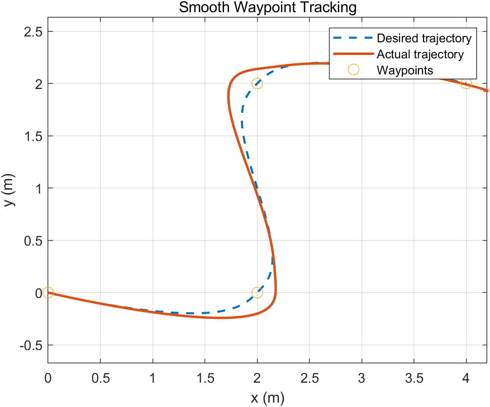
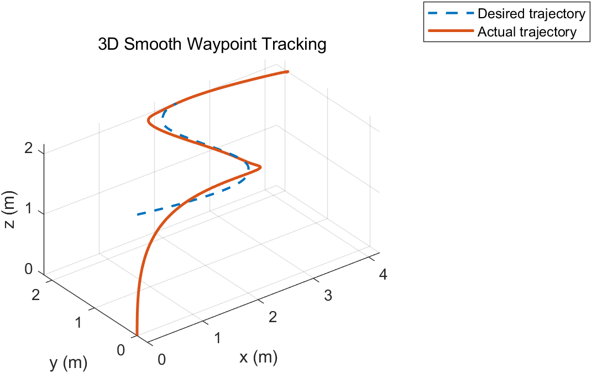
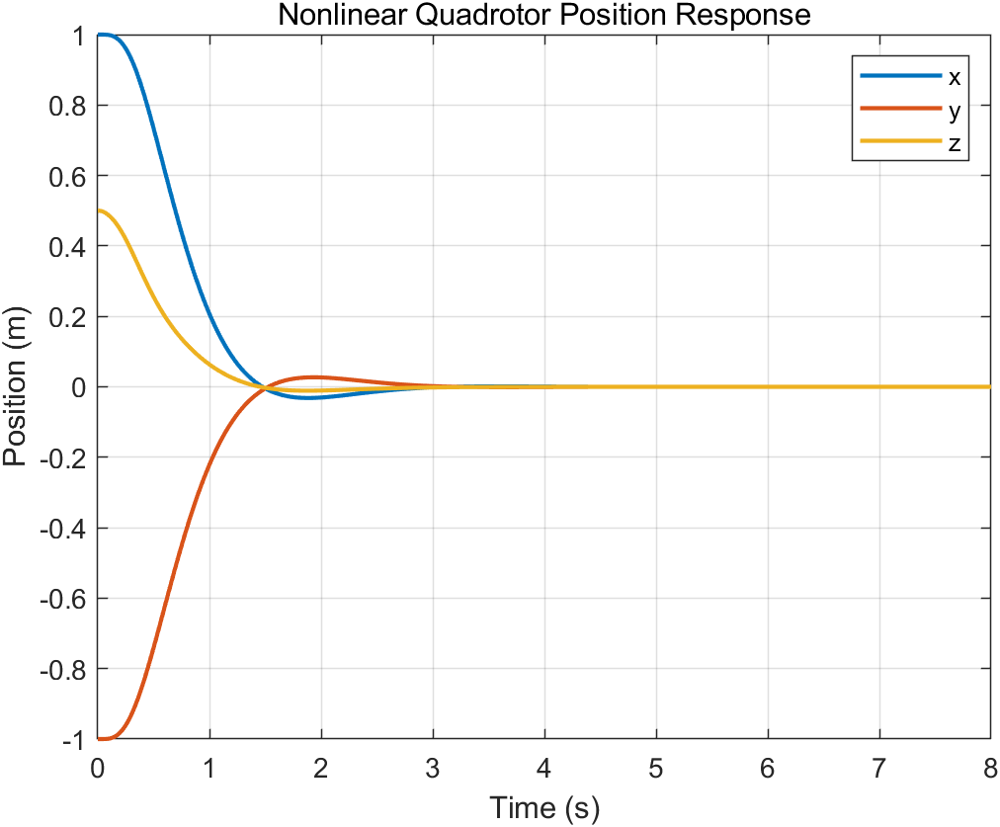
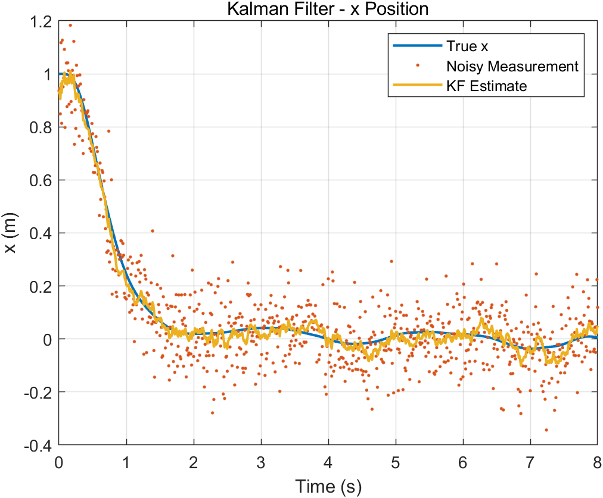

# Quadrotor Flight Control and State Estimation

A MATLAB simulation project that develops a quadrotor model from attitude and rotor-force fundamentals to nonlinear 3D control, trajectory tracking, LQR stabilization, and Kalman-filter-based state estimation.

This repository reorganizes a learning project by engineering topic rather than by week. Each MATLAB script is self-contained and can be run independently.

## Project highlights

- Rigid-body attitude representation using Euler rotation matrices
- Rotor thrust, reaction torque, and body-moment calculation
- 1D and planar translational/rotational dynamics
- Altitude PID control and planar cascaded position-attitude control
- Nonlinear 12-state quadrotor dynamics in 3D
- 3D point stabilization with cascaded control
- Straight-line and smooth waypoint trajectory tracking
- Hover linearization, controllability analysis, and LQR control
- Linear Kalman filtering with noisy position/attitude measurements
- LQR feedback using estimated rather than true state

## Repository structure

```text
quadrotor-flight-control/
|-- 01_fundamentals/
|   |-- attitude_rotation_demo.m
|   |-- rotor_force_moment_demo.m
|   |-- vertical_dynamics_demo.m
|   `-- planar_dynamics_demo.m
|-- 02_pid_and_cascade_control/
|   |-- altitude_pid_control.m
|   `-- planar_cascade_control.m
|-- 03_nonlinear_3d_control/
|   |-- nonlinear_3d_dynamics.m
|   `-- point_tracking_3d.m
|-- 04_trajectory_tracking/
|   |-- straight_line_tracking.m
|   `-- smooth_waypoint_tracking.m
|-- 05_lqr_control/
|   `-- lqr_hover_nonlinear.m
|-- 06_state_estimation/
|   `-- kalman_lqr_closed_loop.m
`-- results/
    `-- README.md
```

## State and input definitions

The nonlinear 3D simulations use the state

```text
X = [x y z vx vy vz phi theta psi p q r]^T
```

and the control input

```text
u = [T tau_x tau_y tau_z]^T
```

where `T` is total thrust and `tau_x`, `tau_y`, and `tau_z` are body torques.

## Requirements

- MATLAB (scripts use local functions, so MATLAB R2016b or later is recommended)
- Control System Toolbox for `lqr`, `ctrb`, and `obsv` in the LQR/Kalman examples

No Simulink model or external dataset is required.

## How to run

1. Clone or download this repository.
2. Open MATLAB and set the current folder to the repository root.
3. Open any script and select **Run**.

Suggested progression:

```text
01_fundamentals
      -> 02_pid_and_cascade_control
      -> 03_nonlinear_3d_control
      -> 04_trajectory_tracking
      -> 05_lqr_control
      -> 06_state_estimation
```

For the most complete demonstrations, start with:

- `04_trajectory_tracking/smooth_waypoint_tracking.m`
- `05_lqr_control/lqr_hover_nonlinear.m`
- `06_state_estimation/kalman_lqr_closed_loop.m`

## Representative results

The cascaded position-attitude controller follows a smooth trajectory through four planar waypoints. The response remains stable, with moderate transient lag and corner-tracking error.



The same simulation in 3D includes the initial climb from ground level to the commanded altitude of 2 m.



The hover-point LQR is designed from a linearized 12-state model and evaluated on the nonlinear quadrotor dynamics. Starting from an offset position, all three position states converge to the hover equilibrium in approximately 3 seconds.



A linear Kalman filter fuses noisy position and attitude measurements, estimates unmeasured velocity and angular-rate states, and supplies the state feedback used by the LQR controller.



## Modeling assumptions

This is an educational simulation intended to demonstrate modeling, control, and estimation concepts. It uses a rigid-body model, Euler angles, idealized thrust/torque inputs, and fixed-step Euler integration. Motor dynamics, actuator saturation, aerodynamic drag, ground contact, and sensor bias are not modeled.

## 中文简介

本项目将自学四旋翼学习代码按工程主题重新整理，内容包括姿态表示、旋翼力与力矩、非线性动力学、PID/串级控制、轨迹跟踪、LQR 以及线性 Kalman Filter。各脚本可独立运行；建议先运行轨迹跟踪、LQR 和 Kalman Filter 三个核心示例，并把生成的关键结果图放入 `results/`。
